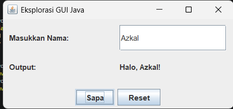

# Eksplorasi Graphical User Interface (GUI) pada Java

Program sederhana berbasis Java Swing untuk menampilkan sapaan berdasarkan input nama pengguna.

## Screenshot Aplikasi

## 5 Komponen Utama GUI yang Digunakan

1. **Top-level Container Class (`javax.swing.JFrame`)**
   - Digunakan sebagai jendela utama aplikasi melalui kelas `EksplorasiGUI extends JFrame`.
2. **Intermediate Container Class (`javax.swing.JPanel`)**
   - Digunakan untuk mengelompokkan komponen input (`panelInput`) dan tombol aksi (`panelTombol`) sebelum dimasukkan ke dalam `JFrame`.
3. **Atomic Component Class (`javax.swing.JLabel`, `javax.swing.JTextField`, `javax.swing.JButton`)**
   - `JLabel` menampilkan teks label dan hasil output, `JTextField` menerima input teks dari pengguna, dan `JButton` memicu aksi klik.
4. **Layout Classes (`java.awt.BorderLayout`, `java.awt.GridLayout`, `java.awt.FlowLayout`)**
   - `BorderLayout` mengatur tata letak utama jendela (`CENTER` dan `SOUTH`).
   - `GridLayout` menyusun form label dan field input dalam bentuk baris dan kolom.
   - `FlowLayout` mengatur deretan tombol secara horizontal di bagian bawah.
5. **Event Listener (`java.awt.event.ActionListener` & `java.awt.event.WindowAdapter`)**
   - `ActionListener` (Interface) meng-override metode `actionPerformed(ActionEvent e)` untuk menangani klik tombol **Sapa** dan **Reset**.
   - `WindowAdapter` (Adapter Class) meng-override metode `windowClosing(WindowEvent e)` untuk menutup jendela aplikasi dengan `dispose()`.
